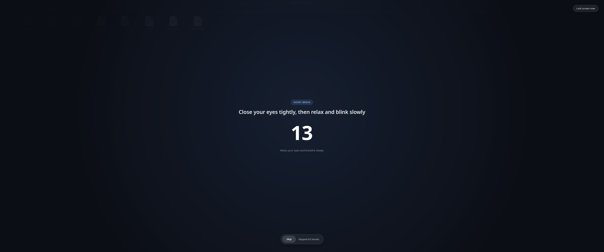
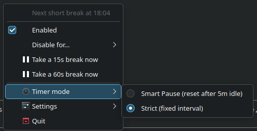

# safeeyes-rs

Protect your eyes from strain with periodic break reminders and a clean, distraction-free fullscreen break overlay.

`safeeyes-rs` is a lightweight, native Wayland Rust rewrite of [SafeEyes](https://github.com/slgobinath/SafeEyes) for Linux (**KDE Plasma** and **GNOME**), preserving the familiar system tray workflow with event-driven, zero-polling Linux/Wayland integration.

🌐 **Website:** https://safeeyes-rs.zfgf.uk/

## Screenshots

### Fullscreen Break Overlay


### System Tray Menu (KDE Plasma)


## Features

- **Native Wayland Fullscreen Overlay**
  - Uses `gtk4-layer-shell` (`Layer::Overlay`, `KeyboardMode::Exclusive`, multi-monitor) on KDE Plasma / wlroots compositors.
  - Automatic fallback to undecorated `gtk4::ApplicationWindow::fullscreen_on_monitor` on GNOME Mutter.
  - Responsive layout with a large integer-second countdown (`tabular-nums`), top-right **Lock screen now** button, bottom **Skip** & **Snooze** buttons with `Skipped X/Y breaks` counter, and `Esc` shortcut.
- **Cross-DE System Tray (`ksni` / StatusNotifierItem)**
  - Next break status line, Enable/Disable toggle, timed disable (*15m / 30m / 1h / 2h / 4h* or until manually enabled), **Take a 15s break now**, **Take a 60s break now**, **Timer mode** switcher, **Settings** (*Preferences...* / *Open config file* / *Reload config*), and **Quit**.
- **Native GTK4 Preferences Window**
  - Lazy-built **Settings → Preferences...** window for editing intervals, break durations, snooze/skip limits, Smart Pause idle thresholds, audio toggle, and custom exercise prompts (dropped from memory when closed).
- **Flexible Timer Modes**
  - **Smart Pause (default):** Uses Wayland `ext-idle-notify-v1` to pause on user inactivity and reset after `idle_reset_seconds` (respects video/media idle inhibitors such as browser playback).
  - **Strict:** Ignores user inactivity and schedules breaks strictly by elapsed time since the last break.
- **Event-Driven & Low Footprint**
  - Zero polling between breaks (single-shot GLib wakeups, D-Bus signal listeners for `org.freedesktop.ScreenSaver` and `org.freedesktop.login1`, and Wayland `ext-idle-notify-v1`).
  - Pre-break desktop notifications via `notify-rust` and lightweight chimes via `pw-play` / `paplay` / `canberra-gtk-play`.

## Installation

### Fedora (COPR)

Install and enable autostart in one command:

```bash
sudo dnf copr enable -y zfgf11/safeeyes-rs && sudo dnf install -y safeeyes-rs && mkdir -p ~/.config/autostart && cp /usr/share/applications/safeeyes-rs.desktop ~/.config/autostart/
```

### Arch Linux (PKGBUILD)

Build and install directly from the included `PKGBUILD`:

```bash
git clone https://github.com/zfgf11/safeeyes-rs.git
cd safeeyes-rs/packaging/aur
makepkg -si
```

### Debian / Ubuntu & Universal Tarball (GitHub Releases)

Prebuilt `.deb` (Debian 13+ / Ubuntu 24.10+), `.rpm`, `.flatpak`, and `.tar.gz` packages with `SHA256SUMS.txt` are published automatically on the [GitHub Releases](https://github.com/zfgf11/safeeyes-rs/releases) page:

```bash
# Debian / Ubuntu (after downloading the .deb from Releases)
sudo apt install ./safeeyes-rs_*.deb
```

### Flatpak (Bundle from GitHub Releases)

Download `safeeyes-rs-v*-x86_64.flatpak` from the [GitHub Releases](https://github.com/zfgf11/safeeyes-rs/releases) page, then double-click it to install via KDE Discover / GNOME Software, or install from the terminal:

```bash
# Ensure Flathub remote is configured for the GNOME runtime, then install:
flatpak remote-add --user --if-not-exists flathub https://dl.flathub.org/repo/flathub.flatpakrepo
flatpak install --user ./safeeyes-rs-*-x86_64.flatpak
flatpak run io.github.zfgf11.safeeyes_rs
```

> **Flatpak Autostart:** Add **SafeEyes-RS** in your desktop's *System Settings → Autostart* (or *GNOME Tweaks → Startup Applications*).

### Build from Source

System development libraries for GTK 4 and `gtk4-layer-shell`:

- **Fedora:**
  ```bash
  sudo dnf install gtk4-devel gtk4-layer-shell-devel
  ```
- **Ubuntu / Debian:**
  ```bash
  sudo apt install libgtk-4-dev libgtk4-layer-shell-dev
  ```
- **Arch Linux:**
  ```bash
  sudo pacman -S gtk4 gtk4-layer-shell
  ```

Build, run, or install into `~/.cargo/bin`:

```bash
cargo build --release
cargo run --release
# or install locally:
cargo install --path .
```

> **GNOME Note:** For the system tray icon to appear on GNOME, ensure the *AppIndicator and KStatusNotifierItem Support* extension is enabled.

## Configuration

On first launch, `safeeyes-rs` creates a default configuration file at:

```text
$XDG_CONFIG_HOME/safeeyes-rs/config.toml   # usually ~/.config/safeeyes-rs/config.toml
```

After editing `config.toml`, apply changes immediately via **Settings → Reload config** in the tray menu.

## License

[MIT](LICENSE)

---

*Note: This project was developed with substantial AI assistance for code generation, refactoring, and packaging.*
